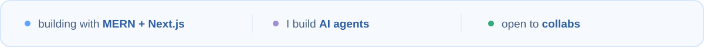
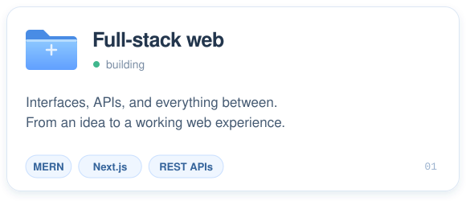
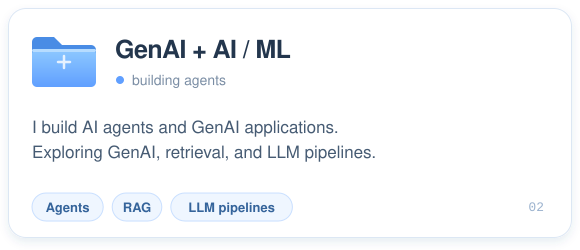
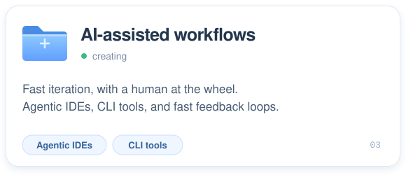
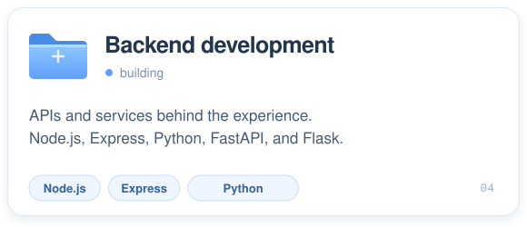
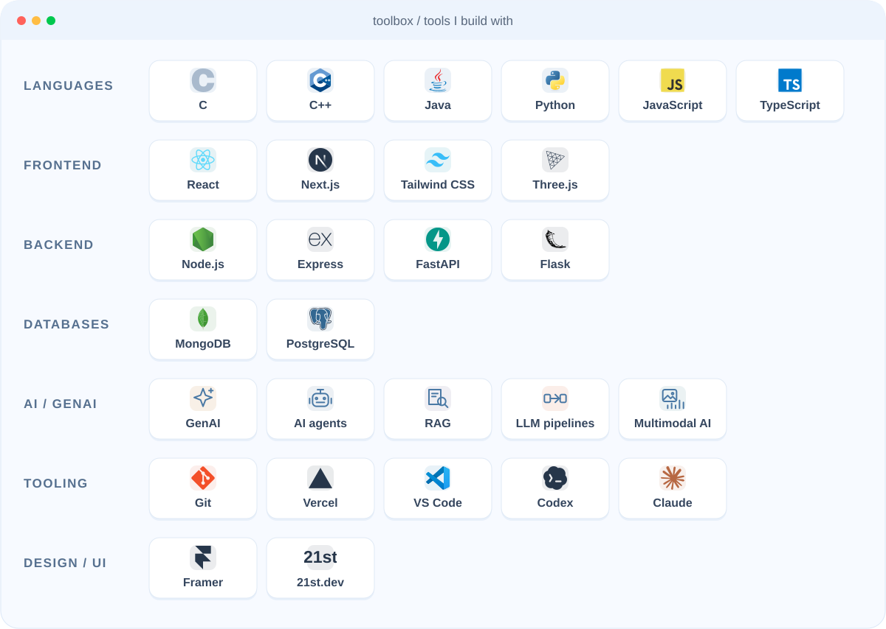

Hey, I'm <strong>Joy</strong>, a full-stack web developer from India. I build web apps with <strong>MERN + Next.js</strong> and <strong>AI agents, RAG pipelines, and GenAI applications</strong>. I use <strong>agentic IDEs and CLI tools</strong> to iterate and ship, while exploring multimodal systems.

<em>“Build it. Break it. Ship it anyway.”</em>

## what I do

  
  
  
  

## the toolbox

## say hi

  
  
  
  

Open to collabs &amp; interesting problems. Got an idea? Let's build it.

